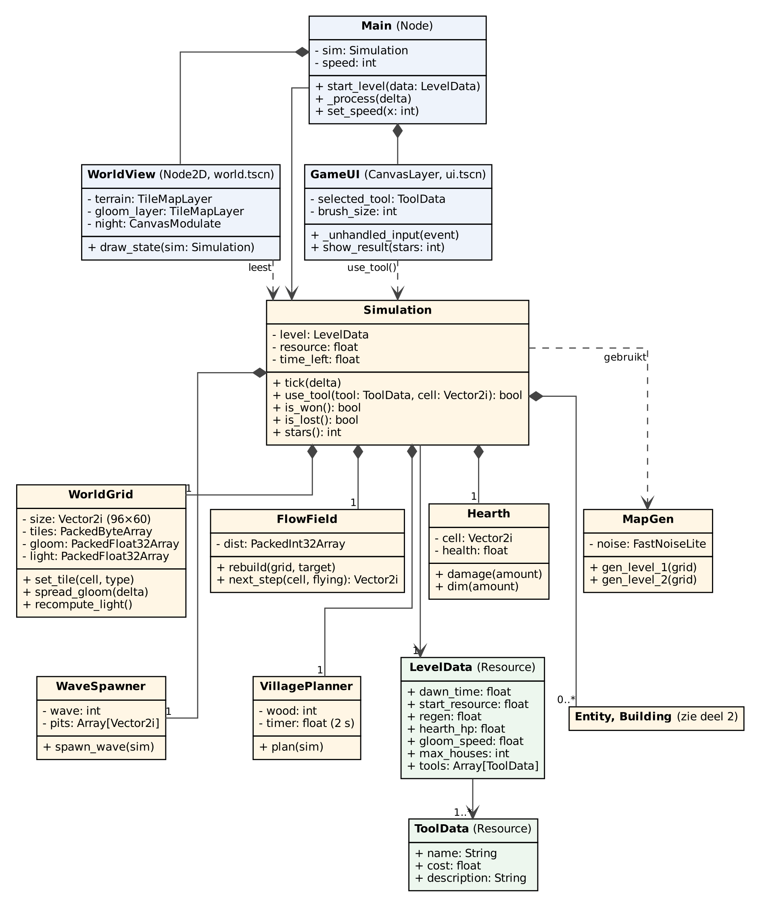
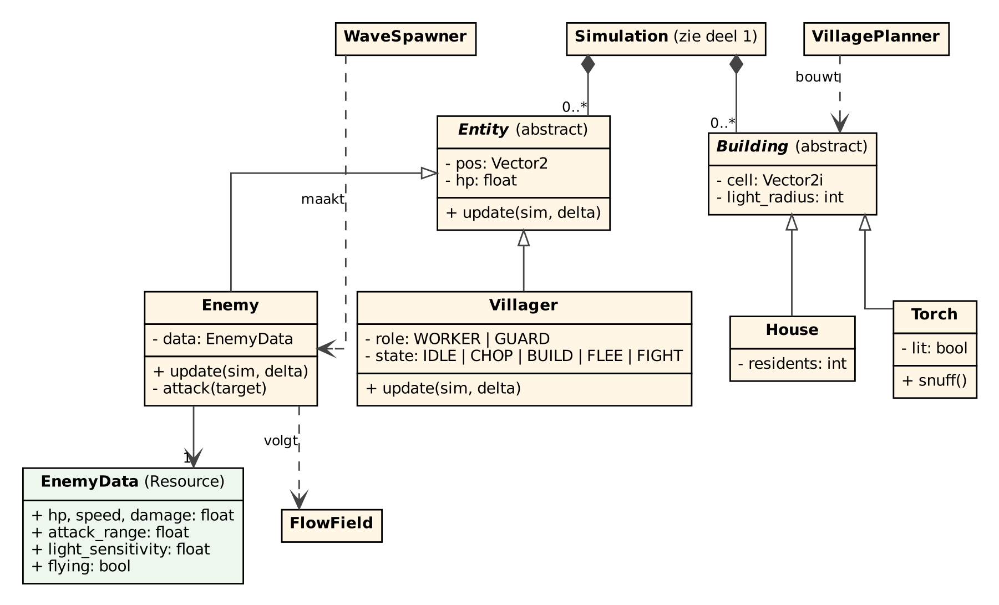
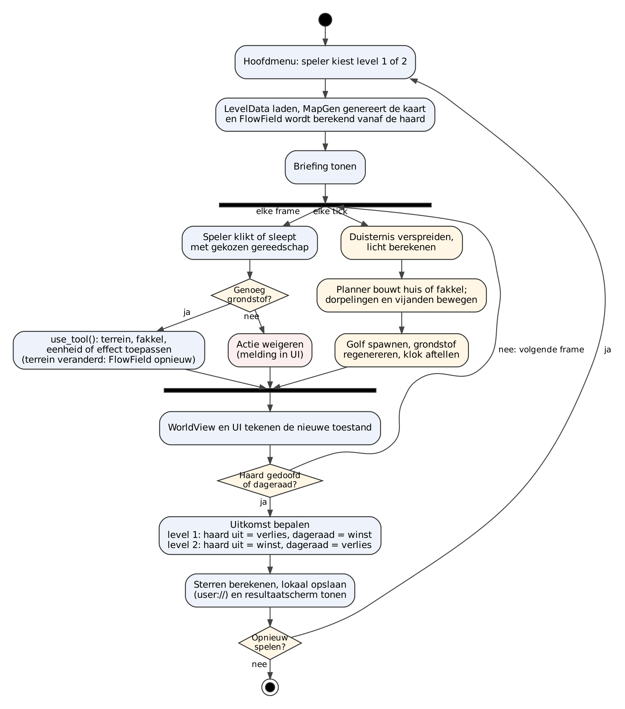

# Last Hearth: opbouw, gebruik en aanpassen

*3 november 2026 · Rex*

> Markdownversie van het design document. Het origineel staat in [`ontwerp/Last_Hearth_Godot_ontwerp.docx`](ontwerp/Last_Hearth_Godot_ontwerp.docx).
> Dit document is **leidend** voor het concept, de klassen en de namen. Wijkt de code ervan af, pas dan eerst dit document aan (in een aparte PR) en daarna de code.

Last Hearth wordt gebouwd in Godot 4 met GDScript, als 2D-pixelartspel zonder externe plug-ins. Het project bestaat uit drie lagen die los van elkaar staan: simulatie, weergave en interface.

> **Noot (fase 0):** "zonder externe plug-ins" geldt voor het spel zelf. De testframework-addon gdUnit4 (`addons/gdUnit4/`) draait alleen in de editor en bij tests, en zit niet in de gameplay.
>
> **Noot (fase 2):** twee technische keuzes wijken af van de tabel hieronder. De gloom-overlay is geen `TileMapLayer` maar één textuur met een shader (`scenes/world/gloom.gdshader`), zodat de duisternis zacht en bewegend getekend wordt. Effecten gebruiken `CPUParticles2D` in plaats van `GPUParticles2D`, omdat die op elke computer werken met de Compatibility-renderer. Alle pixelart is eigen werk (zie `tools/art/`).

## Hoe het in elkaar zit

| Bestand of scène | Taak |
|---|---|
| `sim/` (GDScript) | De simulatie: kaart, dorpelingen, vijanden, golven, licht en duisternis. Gewone GDScript-klassen (`RefCounted`) die geen nodes of scènes aanraken. |
| `world.tscn` | Tekent alles in pixelart: terrein in een `TileMapLayer`, dorpelingen en vijanden als `AnimatedSprite2D`, nacht met `CanvasModulate`, licht met `PointLight2D` en effecten met `GPUParticles2D`. |
| `ui.tscn` en `main.gd` | Muis en toetsen via de InputMap, werkbalk en schermen als `Control`-nodes in een `CanvasLayer`, en de spellus in `_process`. |
| `theme.tres` | Opmaak, lettertypen en kleuren van de interface. Met de stretch-instellingen van het project schaalt alles mee naar andere schermformaten, ook telefoons. |
| Exportpresets | Exporteren vanuit Godot naar een speelbare build voor Windows, en eventueel web (HTML5) of Android. |

Omdat de simulatie los staat van het tekenen, kun je het spel zonder venster testen met bots: Godot draait dan headless (`godot --headless`) met `sim_test.gd` en `bots.gd`. Zo wordt de balans gemeten voordat iemand het met de hand speelt.

De wereld is een raster van **96×60 tegels** in een `TileMapLayer`: water, zand, gras, bos en berg. Het terrein wordt gegenereerd met ruis (`FastNoiseLite`). Daarbovenop liggen twee lagen, die de simulatie per tegel bijhoudt:

- **Duisternis (gloom):** een tegel kan donker zijn. Dat verspreidt zich langzaam vanuit de putten en wordt getoond met een aparte overlay-`TileMapLayer`.
- **Licht:** berekend uit de haard, fakkels en huizen. Op het scherm zijn dat `PointLight2D`-nodes onder een donkere `CanvasModulate`. Licht wist duisternis weg.

De dorpelingen hebben twee rollen. **Arbeiders** hakken hout, bouwen en vluchten bij gevaar. **Wachters** patrouilleren en vechten. Elke ~2 seconden bepaalt een planner of het dorp een huis of fakkel bouwt, afhankelijk van hout en bevolking. Huizen laten het dorp groeien.

De vijanden lopen via een routekaart (**flow field**) die met een breadth-first search vanaf de haard wordt berekend, en opnieuw zodra het terrein verandert. Ze vinden daardoor altijd de snelste weg, ook als jij het terrein aanpast. Er zijn drie soorten:

- **Schaduw:** snel en breekbaar.
- **Brute:** traag en taai.
- **Geest:** vliegt over water en rots.

## Hoe je het speelt

Je bestuurt niemand rechtstreeks, net als in WorldBox: je klikt of sleept op de wereld met het gekozen gereedschap en de simulatie doet de rest. De toetsen **1–7** kiezen gereedschap, **[** en **]** veranderen de penseelgrootte, **spatie** pauzeert (`get_tree().paused`), en een knop schakelt tussen **1x, 2x en 3x** snelheid (`Engine.time_scale`). Alle toetsen staan in de InputMap van het project, zodat ze makkelijk aan te passen zijn.

| | Level 1: Hold the Light | Level 2: Let the Dark In |
|---|---|---|
| **Jouw rol** | Beschermer van het dorp | De duisternis |
| **Doel** | De haard brandend houden tot de ochtend (4:30) | De haard doven vóór zonsopgang (3:40) |
| **Grondstof** | Licht (max 150) | Dread (max 200) |
| **Terrein** | Land, water, bos en berg, 1 per tegel | Drain (water naar droge grond) en Rubble (bergen afbreken), 1 tot 1,5 per tegel |
| **Overig gereedschap** | Fakkel (30), Flare (100, verbrandt alles in de buurt) | Gloom, schaduw (10), geest (22), brute (45), Snuff (60) |
| **Sterren** | Aantal overlevende dorpelingen | Snelheid en aantal gedode dorpelingen |

**Level 1.** Schaduwen komen uit drie Nachtputten naar de haard. Een gracht of berg stuurt ze de lichtcirkel van de fakkels in. Dorpelingen hakken hout en bouwen zelf huizen en fakkels, dus plant bos in de buurt van het dorp.

**Level 2.** Het dorp ligt achter een gracht met een ring fakkels. Je kunt alleen eenheden oproepen op gloom, dus je verspreidt eerst de duisternis richting het dorp. Met Drain leg je een brug door de gracht. Met Snuff doof je fakkels en dim je de haard. Elke gedode dorpeling vertraagt de dageraad een beetje en geeft Dread terug.

## De gedachten erachter

Het ontwerp volgt uit twee wensen: een level en het spiegelbeeld ervan, en terrein als gereedschap.

- **Twee kanten van dezelfde motor.** Beide levels gebruiken dezelfde simulatie met omgekeerde doelen en gereedschappen. Verdedigen leert je hoe aanvallers werken, aanvallen leert je waar het dorp kwetsbaar is.
- **Terrein is het wapen.** Water en bergen zijn geen versiering maar de belangrijkste verdediging. Bruggen en puin zijn de belangrijkste aanval.
- **Licht als centraal systeem.** Eén mechaniek, licht tegen duisternis, draagt beide levels en is meteen leesbaar: je ziet wat veilig is.
- **Het dorp leeft zelf.** Dorpelingen bouwen en vechten zonder jouw hulp. Dat geeft het toekijken-gevoel van WorldBox in plaats van een strategiespel.
- **Balans gemeten, niet geraden.** Bots spelen headless in Godot honderden runs. Het streefbeeld: level 1 is te winnen met goed gebruik van gracht en licht. Level 2 is bewust moeilijker: een bot die spaart en brutes in een groep stuurt moet ongeveer de helft van zijn runs winnen, een bot die eenheden druppelsgewijs stuurt moet altijd verliezen.

## Technisch ontwerp

De diagrammen hieronder laten zien hoe het spel in Godot wordt opgebouwd. De simulatie staat los van de Godot-scènes, zodat beide duo's tegelijk kunnen werken en de bots zonder venster kunnen testen.

### Klassendiagram

Het klassendiagram is in twee delen gesplitst om het leesbaar te houden. Deel 1 toont de structuur: de Godot-scènes (blauw), de simulatie (geel) en de instellingen als Resources (groen). Deel 2 toont de dorpelingen, vijanden en gebouwen. Een ruit betekent "is onderdeel van", een open driehoek is overerving en een stippellijn is een afhankelijkheid.

#### Deel 1: structuur

*Figuur 1. Klassendiagram, deel 1: scènes, simulatie en instellingen*

#### Deel 2: entiteiten en gebouwen

*Figuur 2. Klassendiagram, deel 2: dorpelingen, vijanden en gebouwen*

#### Klassen in tekst

Dezelfde klassen als in figuur 1 en 2, zodat ze doorzoekbaar zijn. `-` is privé, `+` is publiek.

**Godot-scènes (blauw)**

| Klasse | Basis / scène | Velden | Methodes |
|---|---|---|---|
| `Main` | `Node` | `- sim: Simulation`, `- speed: int` | `+ start_level(data: LevelData)`, `+ _process(delta)`, `+ set_speed(x: int)` |
| `WorldView` | `Node2D`, `world.tscn` | `- terrain: TileMapLayer`, `- gloom_layer: TileMapLayer`, `- night: CanvasModulate` | `+ draw_state(sim: Simulation)` |
| `GameUI` | `CanvasLayer`, `ui.tscn` | `- selected_tool: ToolData`, `- brush_size: int` | `+ _unhandled_input(event)`, `+ show_result(stars: int)` |

Relaties: `Main` bevat `WorldView`, `GameUI` en `Simulation`. `WorldView` **leest** `Simulation`. `GameUI` roept **`use_tool()`** aan op `Simulation`.

**Simulatie (geel, `RefCounted`)**

| Klasse | Velden | Methodes |
|---|---|---|
| `Simulation` | `- level: LevelData`, `- resource: float`, `- time_left: float` | `+ tick(delta)`, `+ use_tool(tool: ToolData, cell: Vector2i): bool`, `+ is_won(): bool`, `+ is_lost(): bool`, `+ stars(): int` |
| `WorldGrid` | `- size: Vector2i (96×60)`, `- tiles: PackedByteArray`, `- gloom: PackedFloat32Array`, `- light: PackedFloat32Array` | `+ set_tile(cell, type)`, `+ spread_gloom(delta)`, `+ recompute_light()` |
| `FlowField` | `- dist: PackedInt32Array` | `+ rebuild(grid, target)`, `+ next_step(cell, flying): Vector2i` |
| `Hearth` | `- cell: Vector2i`, `- health: float` | `+ damage(amount)`, `+ dim(amount)` |
| `MapGen` | `- noise: FastNoiseLite` | `+ gen_level_1(grid)`, `+ gen_level_2(grid)` |
| `WaveSpawner` | `- wave: int`, `- pits: Array[Vector2i]` | `+ spawn_wave(sim)` |
| `VillagePlanner` | `- wood: int`, `- timer: float (2 s)` | `+ plan(sim)` |

Relaties: `Simulation` bevat precies één `WorldGrid`, `FlowField`, `Hearth`, `WaveSpawner` en `VillagePlanner`, en 0..* `Entity` en `Building`. `Simulation` **gebruikt** `MapGen` en verwijst naar één `LevelData`.

**Instellingen (groen, `Resource`)**

| Klasse | Velden |
|---|---|
| `LevelData` | `+ dawn_time: float`, `+ start_resource: float`, `+ regen: float`, `+ hearth_hp: float`, `+ gloom_speed: float`, `+ max_houses: int`, `+ tools: Array[ToolData]` |
| `ToolData` | `+ name: String`, `+ cost: float`, `+ description: String` |
| `EnemyData` | `+ hp, speed, damage: float`, `+ attack_range: float`, `+ light_sensitivity: float`, `+ flying: bool` |

Relaties: `LevelData` heeft 1..* `ToolData`. Elke `Enemy` heeft één `EnemyData`.

**Entiteiten en gebouwen (deel 2)**

| Klasse | Erft van | Velden | Methodes |
|---|---|---|---|
| `Entity` *(abstract)* | | `- pos: Vector2`, `- hp: float` | `+ update(sim, delta)` |
| `Villager` | `Entity` | `- role: WORKER \| GUARD`, `- state: IDLE \| CHOP \| BUILD \| FLEE \| FIGHT` | `+ update(sim, delta)` |
| `Enemy` | `Entity` | `- data: EnemyData` | `+ update(sim, delta)`, `- attack(target)` |
| `Building` *(abstract)* | | `- cell: Vector2i`, `- light_radius: int` | |
| `House` | `Building` | `- residents: int` | |
| `Torch` | `Building` | `- lit: bool` | `+ snuff()` |

Relaties: `WaveSpawner` **maakt** `Enemy`. `Enemy` **volgt** het `FlowField`. `VillagePlanner` **bouwt** `Building`s.

### Activiteitendiagram

Het activiteitendiagram toont één speelronde, van hoofdmenu tot resultaat. Na de briefing lopen de invoer van de speler en de simulatie elke frame naast elkaar. Daarna wordt gecontroleerd of de ronde voorbij is. Beide levels volgen dezelfde stroom; alleen de uitkomst is omgekeerd.

*Figuur 3. Activiteitendiagram van één speelronde*

In tekst:

1. Hoofdmenu: de speler kiest level 1 of 2.
2. `LevelData` laden, `MapGen` genereert de kaart en het `FlowField` wordt berekend vanaf de haard.
3. Briefing tonen.
4. Daarna, parallel:
   - **Elke frame (speler):** de speler klikt of sleept met het gekozen gereedschap. Genoeg grondstof? **Ja:** `use_tool()` past terrein, fakkel, eenheid of effect toe (terrein veranderd → `FlowField` opnieuw). **Nee:** actie weigeren, met een melding in de UI.
   - **Elke tick (simulatie):** duisternis verspreiden en licht berekenen → planner bouwt huis of fakkel; dorpelingen en vijanden bewegen → golf spawnen, grondstof regenereren, klok aftellen.
5. `WorldView` en UI tekenen de nieuwe toestand.
6. Haard gedoofd of dageraad? **Nee:** volgende frame (terug naar stap 4). **Ja:** uitkomst bepalen:
   - level 1: haard uit = verlies, dageraad = winst;
   - level 2: haard uit = winst, dageraad = verlies.
7. Sterren berekenen, lokaal opslaan (`user://`) en het resultaatscherm tonen.
8. Opnieuw spelen? **Ja:** terug naar het hoofdmenu. **Nee:** einde.

### Onderbouwing van de keuzes

- **Thema.** Het spel past bij "De wereld leeft zonder jou": het dorp bouwt en vecht zelf. Level 2 voegt "Omgekeerde rollen" toe, want daar speel je de duisternis.
- **Godot.** Gratis en open source, met sterke 2D-tools (`TileMapLayer`, 2D-licht). Scènes en resources zijn tekstbestanden, dus ze werken goed met Git in een team van vier.
- **Simulatie los van weergave.** De spelregels zijn zonder venster te testen, wat de integratietest makkelijk maakt. De interface kan veranderen zonder de logica te raken.
- **Eén simulatie, twee levels.** De casus vraagt per duo één level. Beide duo's delen dezelfde simulatie en werken elk aan een eigen kaartgenerator en `LevelData`. Dat voorkomt dubbel werk en merge-conflicten.
- **Overerving.** `Villager` en `Enemy` erven van `Entity`, `House` en `Torch` van `Building`. Zo werkt de simulatie alles in één lus bij met `update()`.
- **Flow field in plaats van een pad per vijand.** Eén berekening vanaf de haard geldt voor alle vijanden en wordt alleen herhaald als het terrein verandert. Het blijft daardoor snel, ook met veel vijanden.
- **Instellingen in Resources.** De balans is in de Inspector aan te passen zonder code te wijzigen. Dat is sneller bij het testen en geeft minder kans op fouten.
- **Privacy, ethiek en veiligheid.** Het spel heeft geen accounts, verzamelt geen persoonsgegevens en gebruikt geen internet. Alleen de sterren worden lokaal opgeslagen in `user://`. Vijanden zijn abstracte schaduwen zonder bloed, dus het spel is geschikt voor een breed publiek.

## Wat je kunt aanpassen

Veel instellingen staan in Resources (`.tres`-bestanden) die je in de Inspector van Godot aanpast zonder code te openen. Veel aanpassingen zijn dus kleine wijzigingen.

| Onderdeel | Waar | Wat je kunt veranderen |
|---|---|---|
| Levelinstellingen | `LevelData`-resources (`levels/*.tres`) | Duur tot dageraad, startgrondstof, regeneratie, haardgezondheid, snelheid van de duisternis, maximaal aantal huizen |
| Gereedschap | `ToolData`-resources en `use_tool()` in `sim/tools.gd` | Kosten en beschrijvingen. Een nieuw gereedschap is een nieuwe `ToolData`-resource plus een tak in `use_tool()`, en je zet het in de lijst van het level |
| Vijanden | `EnemyData`-resources (`enemies/*.tres`) | Levenspunten, snelheid, schade, aanvalsbereik, gevoeligheid voor licht. Een nieuw type is een nieuwe resource plus `SpriteFrames` in de vijandscène |
| Golven | `spawn_wave()` in `sim/waves.gd` | Formules voor het aantal schaduwen, geesten en brutes per golf |
| Kaarten | `gen_level_1()` en `gen_level_2()` in `sim/mapgen.gd` | Grootte van de gracht, plek van de putten, hoeveelheid bos en bergen. Een nieuw level is een generatiefunctie plus een `LevelData`-resource met briefingtekst |
| Uiterlijk | `theme.tres`, `tileset.tres` en `world.tscn` | Kleuren, sprites, tegels en nachtsfeer (`CanvasModulate` en lichtkleuren) |

> **Noot (fase 0): paden in de repo.** Het design document gebruikt korte paden. In de repo zijn dat:
>
> | Design document | Repo |
> |---|---|
> | `sim/*.gd` | `scripts/sim/*.gd` |
> | `levels/*.tres`, `enemies/*.tres` | `resources/levels/*.tres`, `resources/enemies/*.tres` (gereedschap: `resources/tools/`) |
> | `world.tscn`, `ui.tscn`, `main.gd` | `scenes/world/`, `scenes/ui/`, `scenes/main/Main.tscn` (scripts in `scripts/view/`, `scripts/ui/`) |
> | Levelspecifieke code | `scripts/sim/levels/level_1_*.gd` (duo A) en `level_2_*.gd` (duo B) |
> | `sim_test.gd`, `bots.gd` | `tests/unit/`, `tests/bots/` |

Grotere uitbreidingen die goed passen:

- Meer volkeren en koninkrijken, waar WorldBox zijn verhalen vandaan haalt. Dit is de grootste stap, want nu is er maar één dorp.
- Een vrije zandbakmodus zonder winvoorwaarde.
- Geluid en muziek met `AudioStreamPlayer`-nodes en audiobussen.
- Opslaan van je wereld in `user://` en meer levels.
- Exporteren naar web (HTML5) of Android, zodat het spel op meer apparaten te spelen is.

## Beperkingen en volgende stappen

Het spel wordt binnen drie weken in Godot gebouwd. De balans wordt eerst met headless bots getest en daarna met de hand. Hoe het echt aanvoelt, vooral de moeilijkheid van level 2, moet dus nog blijken.

- Dorpelingen zijn eenvoudig: geen families, geloof of oorlog.
- Geluid zit niet in de eerste versie.
- De sterren worden alleen lokaal opgeslagen (`ConfigFile` in `user://`), niet online.

Volgende stappen:

- [x] Godot 4-project opzetten: mappen `sim/`, `scenes/` en `resources/`, plus de InputMap *(fase 0)*
- [ ] Bots headless laten draaien en de balans van beide levels meten
- [ ] Level 2 zelf spelen en de moeilijkheid bijstellen
- [ ] Kiezen welke uitbreiding als eerste komt: volkeren, zandbak of geluid
