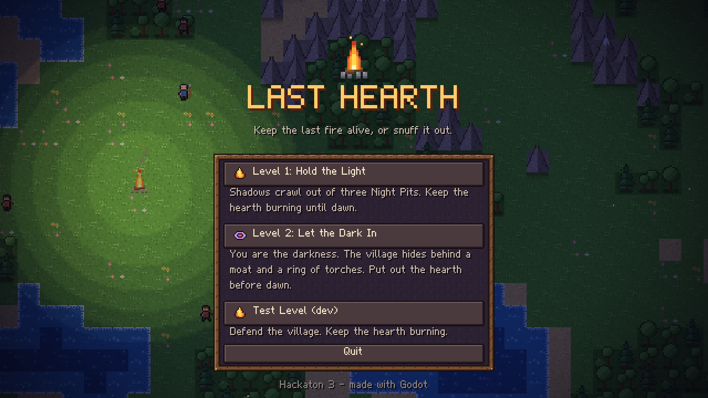
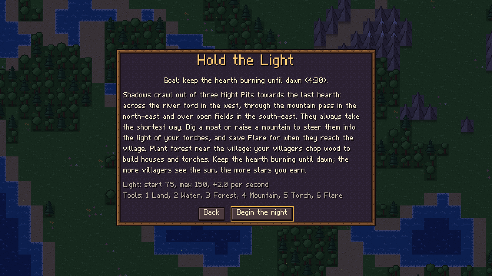
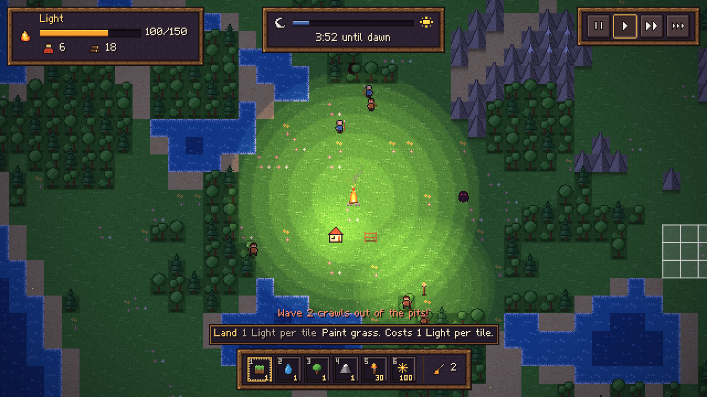
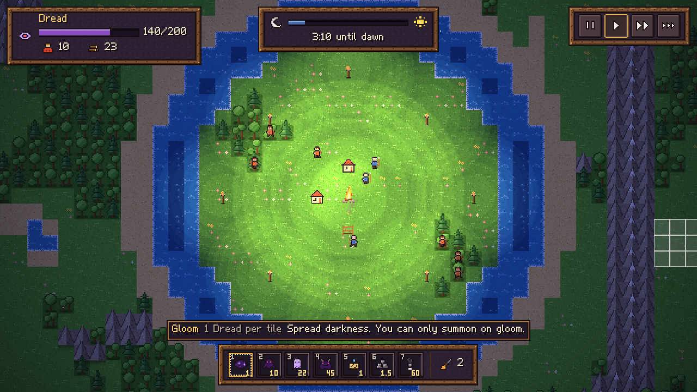

# Handleiding: Last Hearth spelen

Last Hearth speelt zich af in één nacht. Midden op de kaart brandt de laatste haard van een klein dorp, en uit de Nachtputten kruipt de duisternis. Je bestuurt niemand rechtstreeks. Met gereedschappen verander je het terrein, het licht en de duisternis, en het dorp leeft en vecht zelf.

Er zijn twee levels die elkaars spiegelbeeld zijn:

- **Level 1, Hold the Light:** je beschermt het dorp. Houd de haard brandend tot de dageraad.
- **Level 2, Let the Dark In:** jij bent de duisternis. Doof de haard vóór de dageraad.

## Starten

Start het spel (de build, of vanuit Godot met **F5**). Je komt in het hoofdmenu.

Onder elk level staat in één zin wat je moet doen. Klik op een level om de **briefing** te zien: het doel, het verhaal, je grondstof en je gereedschappen. De kaart ligt er al achter. Klik **Begin the night** om te beginnen, of **Back** (of Esc) om terug te gaan. **Quit** sluit het spel.

## Het scherm

| Waar | Wat je ziet |
|---|---|
| Linksboven | Je grondstof: **Licht** (level 1) of **Dread** (level 2), met hoeveel je hebt en het maximum. Daaronder het aantal dorpelingen en het hout van het dorp |
| Midden boven | De nacht: de balk loopt van maan naar zon, met de tijd tot de dageraad |
| Rechtsboven | Pauze en de snelheid 1x, 2x en 3x |
| Onder | De werkbalk. Elk vak toont het icoon, de toets (linksboven in het vak) en de kosten (rechtsonder; rood als je het nu niet kunt betalen). Rechts staat de penseelgrootte |
| Boven de werkbalk | De infostrook: naam, kosten en uitleg van het gekozen gereedschap. Ga met de muis over een ander gereedschap om dat uit te leggen |
| Boven de infostrook | Meldingen, zoals een nieuwe golf, een gevallen dorpeling of waarom iets niet kan |
| Op de kaart | Het penseel: de tegels die je gaat schilderen. Rood betekent dat je te weinig grondstof hebt |

## Besturing

| Actie | Toets of muis |
|---|---|
| Gereedschap kiezen | `1` – `7`, of klik op een vak |
| Gebruiken | Linkermuisknop. Bij terrein en Gloom kun je slepen |
| Penseel kleiner / groter | `[` / `]` (grootte 1 tot 5) |
| Camera bewegen | `W` `A` `S` `D`, de pijltjestoetsen, of slepen met de middelste muisknop |
| Zoomen | Scrollwiel |
| Pauze en verder | Spatie. Tijdens de pauze kun je nog schilderen |
| Pauzemenu openen en sluiten | Esc |
| Naar het hoofdmenu | Spatie in het pauzemenu dat je met Esc opende, of de knop **Main menu** |
| Snelheid 1x → 2x → 3x | Tab, of de knoppen rechtsboven |

## Wat elke nacht gebeurt

- **De klok loopt.** Bij de dageraad is de nacht voorbij.
- **De duisternis (gloom) kruipt** vanuit de putten over de kaart: de donkere, bewegende laag. Hij groeit niet waar licht is, en licht duwt hem langzaam terug.
- **Licht** komt van de haard, van fakkels en van afgebouwde huizen. Vijanden in het licht branden en verliezen levenspunten.
- **Het dorp leeft zelf.** Arbeiders hakken hout in het bos bij de haard en bouwen daarmee huizen (5 hout) en fakkels (3 hout). Een nieuw huis brengt een nieuwe dorpeling. Komt er een vijand dichtbij, dan vluchten arbeiders naar de haard. Wachters (de blauwe dorpelingen) patrouilleren rond de haard en vechten.
- **Vijanden** nemen altijd de kortste weg naar de haard, ook als je het terrein verandert. Onderweg vallen ze dorpelingen aan, en dan de haard. Hoe meer schade de haard krijgt, hoe kleiner zijn licht. Bij 0 gaat hij uit.

| Vijand | Kenmerk |
|---|---|
| Schaduw | Snel en breekbaar, brandt snel in het licht |
| Geest | Vliegt over water en bergen |
| Brute | Traag, taai en slaat hard |

## Level 1: Hold the Light

**Doel:** houd de haard brandend tot de dageraad (4:30). Gaat hij eerder uit, dan verlies je.

Vijanden komen in **golven** uit drie Nachtputten: de eerste na 12 seconden, daarna elke 22 seconden. Elke golf is groter. Vanaf golf 3 komen er geesten mee, vanaf golf 5 brutes. Elke put heeft zijn eigen weg: een doorwaadplaats door de rivier in het westen, een pas door de bergen in het noordoosten en open grasland in het zuidoosten.

Je betaalt met **Licht**: je begint met 75, het maximum is 150, en er komt 2 per seconde bij.

| Toets | Gereedschap | Kosten | Wat het doet |
|---|---|---|---|
| 1 | Land | 1 per tegel | Maakt gras (ook van water: een dam) |
| 2 | Water | 1 per tegel | Maakt water. Lopende vijanden kunnen er niet door: een gracht |
| 3 | Forest | 1 per tegel | Plant bos. Het dorp hakt er hout |
| 4 | Mountain | 1 per tegel | Maakt een berg. Lopende vijanden moeten eromheen |
| 5 | Torch | 30 | Zet meteen een brandende fakkel neer. Zijn licht verbrandt vijanden en houdt gloom weg |
| 6 | Flare | 100 | Doodt meteen elke vijand binnen 6 tegels en veegt de gloom daar weg |

Je mag een put nooit helemaal van de haard afsnijden, en ook geen lopende vijand insluiten. Zo'n streek wordt geweigerd en kost niets.

**Sterren:** verlies geeft 0. Win je, dan krijg je 1 ster, 2 als minstens 60% van alle dorpelingen de dageraad haalt, en 3 bij minstens 90%.

**Tips:**
- Stuur vijanden met een gracht of berg langs je fakkels, in plaats van ze tegen te houden.
- Plant bos dicht bij het dorp: meer hout betekent meer huizen, meer dorpelingen en meer fakkels.
- Bewaar een Flare voor het moment dat een golf toch bij het dorp komt.

## Level 2: Let the Dark In

**Doel:** doof de haard vóór de dageraad (3:40). Komt de zon op en brandt hij nog, dan verlies je.

Het dorp ligt achter een **gracht met een ring fakkels**. Er komen geen golven: jij roept de vijanden op.

Je betaalt met **Dread**: je begint met 50, het maximum is 200, en er komt 3 per seconde bij.

| Toets | Gereedschap | Kosten | Wat het doet |
|---|---|---|---|
| 1 | Gloom | 1 per tegel | Verspreidt duisternis. Gloom groeit alleen vanuit gloom: een tegel wordt pas donker naast een tegel die al helemaal donker is. In licht werkt het niet |
| 2 | Shadow | 10 | Roept een schaduw op |
| 3 | Wraith | 22 | Roept een geest op, die over water en bergen vliegt |
| 4 | Brute | 45 | Roept een brute op |
| 5 | Drain | 1 per tegel | Maakt van water droge grond: een brug door de gracht |
| 6 | Rubble | 1,5 per tegel | Breekt een berg af |
| 7 | Snuff | 60 | Dooft alle fakkels binnen 4 tegels en dimt de haard als die erbinnen staat |

Eenheden oproepen kan **alleen op gloom**. Begin dus bij de putten en verspreid de duisternis richting het dorp.

Elke **gedode dorpeling** schuift de dageraad 5 seconden op en geeft 15 Dread terug. De melding laat zien wat je kreeg.

**Sterren:** verlies geeft 0. Doof je de haard, dan krijg je 1 ster. Er komt er een bij als de haard binnen 60% van de nacht uit was, en nog een als je minstens de helft van alle dorpelingen hebt gedood.

**Tips:**
- Maak eerst een brug met Drain. Lopende eenheden wachten anders aan het water.
- Doof fakkels met Snuff vóórdat je leger erlangs loopt, anders verbranden je eenheden in hun licht.
- Spaar Dread en stuur brutes in een groep: één voor één halen ze het niet.

## Het einde van een nacht

Als de haard uitgaat of de dageraad komt, zie je het resultaatscherm: of je gewonnen hebt en hoeveel sterren je haalde. Kies **Play again** voor dezelfde nacht opnieuw, of **Main menu** (of Esc).

## Waarom gebeurt er niets?

Als een gereedschap niets doet, zegt een melding waarom:

| Melding | Betekenis |
|---|---|
| *Not enough Light.* / *Not enough Dread.* | Je hebt te weinig grondstof. Wacht even: hij groeit vanzelf aan |
| *The dark must always have a way to the hearth.* | Je streek zou een put of een lopende vijand helemaal afsnijden |
| *Summon only on gloom.* | Je probeert een eenheid op te roepen op een tegel zonder gloom |
| *Gloom only grows from the dark.* | Gloom kan alleen groeien naast tegels die al donker zijn, en niet in licht |

Geen melding? Dan was er niets te veranderen, bijvoorbeeld water schilderen op water.

**Speel je vanuit de Godot-editor en blijft het beeld klein als je het venster groter maakt?** Kies in de Game-tab, in het ⋮-menu naast `1280x720`, de optie **Stretch to Fit**.
