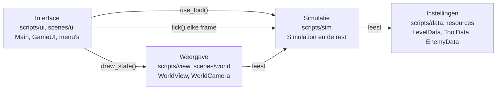

# Systeemdocumentatie: hoe de code van Last Hearth werkt

Voor een nieuwe ontwikkelaar: hoe het project in elkaar zit, waar je wat vindt en hoe je iets toevoegt. Het concept en de oorspronkelijke klassen staan in [`design.md`](design.md). Dit document beschrijft de code zoals die nu is; waar die van het design afwijkt, staat dat [onderaan](#verschillen-met-het-design-document).

Installeren, starten en tests draaien staan in de [README](../README.md). Afspraken over git, branches en de Definition of Done staan in [`CLAUDE.md`](../CLAUDE.md).

## Architectuur in het kort

Het spel bestaat uit drie lagen die alleen in één richting van elkaar afhangen:

- **Simulatie** (`scripts/sim/`): alle spelregels. Gewone `RefCounted`-klassen zonder `Node`, scène, `Input` of `get_tree()`. Daardoor is alles headless te testen (gdUnit4, en later bots).
- **Weergave** (`scripts/view/`, `scenes/world/`): tekent de toestand van de simulatie. Verandert zelf niets aan de spelregels.
- **Interface** (`scripts/ui/`, `scenes/ui/`): menu's, de spellus, de werkbalk en invoer. Verandert de wereld **alleen** via `Simulation.use_tool()`.
- **Instellingen** (`scripts/data/`, `resources/`): alle balans in `.tres`-bestanden, aan te passen in de Inspector.

De simulatie weet niets van de weergave. Wil de weergave iets weten dat net gebeurde (een geschilderde tegel, een Flare), dan luistert ze naar een signaal van de simulatie.

## Waar vind je wat

| Map | Inhoud | Meer uitleg |
|---|---|---|
| `scripts/sim/` | De simulatie: `Simulation` en alle klassen hieronder | [`scripts/README.md`](../scripts/README.md) |
| `scripts/sim/levels/` | Levelspecifiek: `level_1_*.gd` (duo A), `level_2_*.gd` (duo B) | |
| `scripts/data/` | `LevelData`, `ToolData`, `EnemyData` (klassen van de `.tres`-bestanden) | |
| `scripts/view/`, `scenes/world/` | `WorldView`, `WorldCamera`, `BrushPreview`, de gloom-shader | [`scenes/README.md`](../scenes/README.md) |
| `scripts/ui/`, `scenes/ui/`, `scenes/main/` | `Main` (spellus), `GameUI`, `MainMenu`, `Briefing`, `ResultScreen` | |
| `resources/` | Levels, gereedschappen, vijanden en het UI-thema | [`resources/README.md`](../resources/README.md) |
| `assets/` | Sprites, tegels, iconen, lettertypen (alles eigen werk, CC0) | [`assets/README.md`](../assets/README.md) |
| `tools/art/` | Scripts die alle pixelart, de tileset en de lettertypen tekenen | [`tools/README.md`](../tools/README.md) |
| `tests/unit/`, `tests/integration/` | gdUnit4-tests | [`tests/README.md`](../tests/README.md) |

## Eén frame

`scenes/main/Main.tscn` (`scripts/ui/main.gd`) is de spellus. Hij bewaart de `Simulation` van de ronde en schakelt tussen de schermen hoofdmenu → briefing → spelen → resultaat.

Elke frame tijdens het spelen:

1. `Main._process(delta)` roept `sim.tick(delta)` aan (niet tijdens de pauze).
2. `Simulation.tick()` doet in deze volgorde:
   1. klok aftellen en grondstof laten aangroeien (`level.regen`, tot `max_resource`);
   2. de putten blijven donker, en het licht wordt opnieuw berekend uit `light_sources()`;
   3. gloom verspreiden, in stappen van 0,1 s (`GLOOM_STEP`, om tijd te sparen);
   4. `VillagePlanner.plan()` en `WaveSpawner.update()`;
   5. elke vijand en elke dorpeling `update()`;
   6. doden opruimen: tellen, en in level 2 de beloning per kill;
   7. kijken of de ronde voorbij is (`level_finished`).
3. `WorldView.draw_state(sim)` tekent de nieuwe toestand en `GameUI.refresh()` werkt balken, klok en werkbalk bij.

Invoer van de speler gaat andersom: `GameUI` zet een muisklik om naar een tegel en roept `sim.use_tool(tool, cell, brush)` aan. Geeft dat `false`, dan zegt `sim.last_refusal` waarom, en toont `GameUI` een melding.

Pauze gebruikt `get_tree().paused`: de simulatie staat stil, maar camera, UI en schilderen werken door. Snelheid gebruikt `Engine.time_scale`; de camera rekent dat terug, zodat hij op 3x even snel beweegt.

## De simulatie

| Klasse | Taak |
|---|---|
| `Simulation` | Eén ronde: wereld, haard, grondstof, klok, eenheden en gebouwen. Bevat `tick()`, `use_tool()`, `is_won()`, `is_lost()`, `stars()` en de terrein-, fakkel- en Flare-gereedschappen |
| `WorldGrid` | De kaart van 96×60 tegels: terrein (`WATER`, `SAND`, `GRASS`, `FOREST`, `MOUNTAIN`), gloom (0–1), licht (0–1) en een gloom-snelheid per tegel. Index is `y * 96 + x` |
| `MapGen`, `MapLayout` | Kaart maken uit `map_type` en `map_seed` met ruis (`FastNoiseLite`); `MapLayout` bewaart haard, putten en fakkels van de kaart |
| `FlowField` | Breadth-first search vanaf de haard: voor elke tegel de volgende stap naar de haard, apart voor lopers en vliegers. Wordt opnieuw berekend als het terrein verandert |
| `PathFinder` | Een pad voor één dorpeling naar een boom of bouwplaats |
| `Hearth` | Levenspunten, helderheid en licht. Schade en Snuff maken de lichtcirkel kleiner |
| `LightSource` | Een lichtbron (plek en straal), van haard, fakkel of huis |
| `Entity` → `Villager`, `Enemy` | Alles wat beweegt. `Villager`: arbeider (hakken, bouwen, vluchten) of wachter (patrouilleren, vechten). `Enemy`: volgt het `FlowField`, brandt in licht, valt dorpelingen en de haard aan |
| `Building` → `House`, `Torch` | Eerst bouwplaats, dan af. Een af huis geeft licht en een dorpeling; een fakkel geeft licht tot hij gedoofd wordt |
| `VillagePlanner` | Elke 2 s: een huis (5 hout) of fakkel (3 hout), op een plek met een beetje willekeur |
| `WaveSpawner` | Golven uit de putten, groter per golf (`wave_size(n)`) |
| `Level1Map`, `Level1Rules` | Kaart en sterren van level 1 |
| `Level2Map`, `Level2Rules`, `Level2Tools` | Kaart, sterren en de gereedschappen Gloom, oproepen en Snuff van level 2 |

Alle toeval komt uit `sim.rng`, die de `map_seed` van het level gebruikt: dezelfde seed geeft dezelfde kaart en dezelfde nacht. Tests gebruiken daarom altijd een vaste seed.

Posities van eenheden zijn in tegels (`Vector2`); `WorldView` rekent ze om naar pixels (16 per tegel).

### Signalen van `Simulation`

| Signaal | Wanneer | Wie luistert |
|---|---|---|
| `tile_changed(cell)` | Een gereedschap veranderde een tegel | `WorldView` tekent de tegel en zijn buren opnieuw |
| `level_finished(won)` | De ronde is voorbij | Nog niemand: `Main` kijkt zelf elke frame naar `is_over()` |
| `wave_spawned(wave)` | Een golf kwam uit de putten | `Main` toont een melding |
| `villager_died(villager)` | Een dorpeling is gedood | `Main` toont een melding (in level 2 met de beloning) |
| `building_finished(building)` | Een huis of fakkel is af | |
| `flare_used(cell, radius)` | Een Flare ontplofte | `WorldView` toont een flits |

### Waarom een gereedschap niets doet

`use_tool()` geeft `false` en zet `last_refusal`. `GameUI._show_refusal()` maakt er een melding van:

| `Refusal` | Melding |
|---|---|
| `NOT_ENOUGH_RESOURCE` | *Not enough Light.* / *Not enough Dread.* |
| `CUTS_OFF_PIT` | *The dark must always have a way to the hearth.* (een put of lopende vijand zou afgesneden worden) |
| `NEEDS_GLOOM` | *Summon only on gloom.* of *Gloom only grows from the dark.* |
| `NOT_AVAILABLE` | *… is not available yet.* (een `Kind` zonder tak in `use_tool()`) |
| `NO_EFFECT`, `ROUND_OVER` | Geen melding: er was niets te veranderen |

## Instellingen

| Klasse | Belangrijkste velden |
|---|---|
| `LevelData` | `goal` (`DEFEND` of `EXTINGUISH`), `map_type`, `map_seed`, `dawn_time`, grondstof (`resource_label`, `start_resource`, `max_resource`, `regen`), beloning per kill, `hearth_hp`, `gloom_speed`, `start_villagers`, golven (`first_wave_at`, `wave_interval`; 0 = geen golven), de drie vijandtypen en `tools` (maximaal 7) |
| `ToolData` | `id`, `name`, `kind`, `cost` (per tegel voor terrein en Gloom, anders per keer), `radius`, `enemy` (bij oproepen), `icon`, `description` |
| `EnemyData` | `hp`, `speed`, `damage`, `attack_range`, `light_sensitivity`, `flying` |

Welke waarden uit het design document komen en welke tijdelijk zijn, staat in [`resources/README.md`](../resources/README.md).

## Weergave en interface

- **`WorldView`** (`scenes/world/world.tscn`): lagen `Terrain` en `Shore` (`TileMapLayer`), `Objects` (y-gesorteerd: bomen, bergtoppen, de haard, eenheden en gebouwen als sprites), `Gloom` (één textuur met één pixel per tegel, getekend door `gloom.gdshader`), `Lights` (een `PointLight2D` per lichtbron), `Night` (`CanvasModulate`, naar de dageraad toe lichter) en `Overlay` (vuurvliegjes, `BrushPreview`).
- **`WorldCamera`**: pannen, zoomen en binnen de kaart blijven, ook als het venster van grootte verandert.
- **`GameUI`** (`scenes/ui/ui.tscn`): bovenbalk, werkbalk, infostrook, meldingen, pauzescherm en `ResultScreen`. Knoppen hebben `focus_mode = None`, want spatie en Tab zijn speltoetsen.
- **`MainMenu`** en **`Briefing`**: de levels staan in de `levels`-lijst van `main_menu.tscn`. Het testlevel staat er alleen in een debug-build bij.
- **Schermformaat:** basisresolutie 640×360, `stretch/mode = canvas_items`, `stretch/aspect = expand`. Zet UI dus altijd met anchors vast.

## Stappenplannen

### Een nieuw gereedschap

1. **Soort.** Kan het met een bestaande `ToolData.Kind`? Dan sla je stap 2 over. Anders: voeg een waarde toe aan `Kind` in `scripts/data/tool_data.gd`. Een terreingereedschap zet je ook in `TERRAIN_KINDS`.
2. **Regel.** Voeg een tak toe in `Simulation.use_tool()`. Bij een terreingereedschap: een geval in `_terrain_after()`. Kijk naar `_place_torch()` of `_use_flare()` als voorbeeld. Levelspecifieke regels horen in `scripts/sim/levels/` (zoals `Level2Tools`). Geef `true` terug als het iets deed; anders `_refuse(reden)`.
3. **Melding.** Een nieuwe reden om te weigeren? Voeg die toe aan `Simulation.Refusal` en geef hem een tekst in `GameUI._show_refusal()`.
4. **Signaal.** Moet de weergave iets laten zien (zoals de Flare-flits)? Laat de simulatie een signaal geven en laat `WorldView` erop reageren.
5. **Resource.** Maak `resources/tools/tool_<naam>.tres` met id, naam, kind, kosten, straal en een korte Engelse uitleg (die staat in de infostrook).
6. **Icoon.** Teken een icoon van 16×16 in dezelfde stijl met `tools/art/make_ui_art.gd`, en zet het in `ToolData.icon`.
7. **Level.** Zet het gereedschap in de `tools`-lijst van het level (maximaal 7, de volgorde is de toets) en vermeld het in de briefing.
8. **Tests.** Een unittest voor de regel (vaste seed, kleine kaart met `WorldGrid.from_rows()`) en een integratietest met de echte `.tres`, zoals `tests/unit/level_1_tools_test.gd`.

### Een nieuw level

1. **Kaart.** Voeg een waarde toe aan `LevelData.MapType` en een geval in `MapGen.generate()`. Schrijf de kaart in `scripts/sim/levels/level_<n>_map.gd` met een statische `generate(grid, gen) -> MapLayout`, zoals `Level1Map`.
2. **Instellingen.** Maak `resources/levels/level_<n>.tres` (kopieer `level_1.tres`): titel, `summary` (zin in het menu), briefing, doel, kaarttype en seed, tijd, grondstof, golven en gereedschappen.
3. **Sterren.** Schrijf `Level<n>Rules.stars(sim)` en roep die aan in `Simulation.stars()` (een `match` op `level.goal`). Een nieuw soort doel vraagt ook een tak in `is_won()`, `is_lost()` en `ResultScreen.title_for()`.
4. **Menu.** Zet de `.tres` in de `levels`-lijst van `scenes/ui/main_menu.tscn`. Vraag eerst in de groep of iemand die scène bewerkt.
5. **Tests.** Een test voor de kaart (putten bereikbaar, haard op zijn plek) en voor de sterren, zoals `level_1_map_test.gd` en `level_1_rules_test.gd`.

### Een nieuw vijandtype

1. Maak `resources/enemies/enemy_<naam>.tres` met hp, snelheid, schade, bereik, lichtgevoeligheid en of hij vliegt.
2. Teken de sprite als nieuwe rij in `units.png` via `tools/art/make_world_art.gd`, en zet zijn `id` met het rijnummer in `WorldView.ENEMY_ROWS`.
3. Voor golven: een veld in `LevelData` en een plek in `WaveSpawner.wave_size()`. Om op te roepen: een `SUMMON`-gereedschap met `enemy` ingevuld.

### De balans aanpassen

Pas de `.tres`-bestanden aan in de Inspector. Sterrengrenzen staan als constanten in `Level1Rules` en `Level2Rules`. Verander je een waarde die uit het design document komt, pas dan ook `design.md` en de test in `tests/unit/*_resources_test.gd` aan.

## Testen

- `./run_tests.sh` controleert eerst alle scripts op GDScript-waarschuwingen (exitcode 2 bij een waarschuwing), en draait dan alle gdUnit4-tests headless.
- `tests/unit/`: één bestand per sim-klasse, met kleine kaarten uit tekst (`WorldGrid.from_rows()` en `MapLayout.from_rows()`: `~` water, `,` zand, `.` gras, `T` bos, `^` berg, `P` put en `H` haard op gras).
- `tests/integration/`: scènes met een simulatie: `Main`, `GameUI`, `WorldView`, en de levels met hun echte gereedschappen.
- Elke nieuwe sim-klasse krijgt een test. Gebruik een vaste seed als er toeval in zit.

## Verschillen met het design document

| Design document | Code |
|---|---|
| `sim/tools.gd` voor de gereedschappen | Terrein, fakkel en Flare in `Simulation`; Gloom, oproepen en Snuff in `scripts/sim/levels/level_2_tools.gd` |
| `sim/waves.gd`, `sim/mapgen.gd` | `wave_spawner.gd`, `map_gen.gd`, met de kaarten per level in `scripts/sim/levels/` |
| Gloom als `TileMapLayer` | Eén textuur met een shader (`gloom.gdshader`), zodat de duisternis zacht en bewegend is |
| Eenheden als `AnimatedSprite2D` | `Sprite2D` per eenheid uit `units.png`, met twee loopframes |
| `GPUParticles2D` | `CPUParticles2D`: werkt op elke computer met de Compatibility-renderer |
| `GameUI.show_result(stars)` | `GameUI.show_result(won, stars)` |
| Sterren opslaan in `user://` | Nog niet gebouwd (US-11) |
